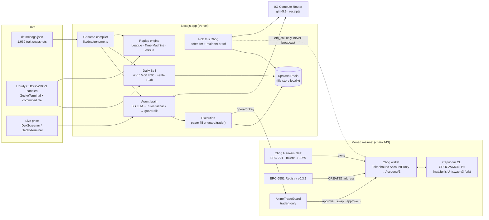

# Animr architecture

This document describes the code as it is. File paths point to where each piece lives.

## 1. The big picture



## 2. Wallets: ERC-6551 and Tokenbound

**File:** `lib/erc6551.ts`

| Piece | Address (Monad mainnet) |
| --- | --- |
| ERC-6551 Registry v0.3.1 (canonical) | `0x000000006551c19487814612e58FE06813775758` |
| Tokenbound `AccountProxy` (the implementation passed to the registry) | `0x55266d75D1a14E4572138116aF39863Ed6596E7F` |
| Tokenbound `AccountV3Upgradable` (what the proxy is initialized with) | `0x41C8f39463A868d3A88af00cd0fe7102F30E44eC` |
| Chog Genesis (ERC-721) | `0xc96d31F8626c6D03Fae5dCD3d61e3FB9F4a73763` |
| $CHOG (ERC-20, 18 decimals) | `0x350035555E10d9AfAF1566AaebfCeD5BA6C27777` |
| Multicall3 | `0xcA11bde05977b3631167028862bE2a173976CA11` |

- **Address.** `computeTokenBoundAccount()` rebuilds the registry's 183-byte ERC-1167 init code and computes the CREATE2 address locally, with no RPC call. It matches `registry.account(...)` for salt 0 and chain 143. Tokens can be sent to the address before the account exists.
- **Status.** An account is `none` (no code), `uninitialized` (proxy deployed but its ERC-1967 slot is empty, so every call "succeeds" and does nothing) or `ready`.
- **Create and initialize in one transaction.** `createAndInitializeAccountRequest()` is a `Multicall3.aggregate3` of `registry.createAccount` and `AccountProxy.initialize(AccountV3)`. Both calls are permissionless.
- **Lookups.** Token IDs run 1–1969. Marketplaces show the number in the metadata name instead ("CHOG #1462" is token 1). `lib/chog-id.ts` maps one to the other: the `/app` lookup and the League search accept either, and the genome card, the Chog page and Versus show both ("CHOG #1462 · token 1"). URLs and the Time Machine header use the token ID.

## 3. Meet: trait snapshot → genome

**Files:** `scripts/snapshot-chogs.mts`, `data/chogs.json`, `lib/dna/genome.ts`, `lib/dna/chogs.ts`

- **Snapshot.** `snapshot-chogs.mts` reads every `tokenURI` through Multicall3, fetches the metadata from IPFS with gateway fallbacks, and writes 1,969 Chogs with their traits. There are 13 trait types: Background, Base, Skin, Side, Body, Mouth, Eyes, Head, Accessory, Form, Tier, Naked and Aura.
- **Genome.** `deriveGenome(traits, name)` is a pure function. A readable gene table matches trait values to 8 genes, each shown with the trait that set it, when one did (a Chog without that trait gets the default):
  - **Signal**, from the Eyes: momentum, contrarian, panic, trend, dip, chaos, sleeper or steady
  - **Horizon**, from the Side: facing right reads the hourly chart, otherwise the last 24 hours
  - **Trigger**, from the Aura
  - **Size**, from the Head, else the Tier
  - **Exit** (take-profit), from the Mouth, or a "jeet" Head
  - **Bias**, from the Accessory
  - **Tempo**, from the Head, the Accessory or the Eyes
  - **Nerve** (how it takes a loss), from a WAGMI Head, a skull or a radioactive trait

  Two parameters sit beside the genes: the Tier sets the exposure cap and a conviction bonus, and a seed from all the traits fine-tunes the trigger. The ten 1:1 Legendaries have no visual traits, so they get signature traits from their names.
- **Versioning.** `GENOME_VERSION` is `g<rev>-<keccak of the whole table and the replay constants>`, currently `g1-7de62b`. It is shown next to every result. Change any rule and the version changes.
- **One genome drives everything.** The replay engine, the live "instinct" (the rules brain), the LLM's character sheet and the Bell forecast all read the same genome.

## 4. Rewind: candles and the replay engine

**Files:** `lib/dna/history.ts`, `lib/dna/backtest.ts`, `lib/dna/population.ts`, `data/chog-ohlcv-1h.json`

- **Candles.** Hourly OHLCV comes from GeckoTerminal for pool `0x116e7D070f1888B81E1E0324F56d6746B2D7d8f1`, priced in WMON per CHOG and checked to be CHOG/WMON (not the inverse). The public API only serves 180 days, so the history is committed in `data/chog-ohlcv-1h.json` (4,992 traded hours, from Mar 18, 2026) and the live API tops it up.
  - Freshness: a 10-minute cache per instance, plus a shared recent copy in KV.
  - Concurrency: one refresher at a time, behind a lock.
  - Failures: exponential backoff that honours `Retry-After`, with the committed file as the fallback.
- **Replay.** `replay()` is deterministic. At each hourly close the genome's instinct decides. The paper venue fills the trade with the pool's **1% fee plus price impact** against ~4M WMON of depth. The portfolio is valued in $CHOG.
  - Every Chog starts with 1,000 $CHOG. Just holding stays at 1,000, so the final value is the edge.
  - The cooldown, size and exposure caps and the confidence floor apply, as for a live agent.
- **Windows.** 30d, 45d (the default) and max. Windows start at a UTC midnight, so they move once a day; the end moves every hour.
- **League and Trait Alpha.** All 1,969 genomes are replayed over the same candles. Results are cached per *(genome version, window, last candle)*.
  - Trait Alpha is the median edge per trait value, for values carried by at least 10 Chogs.
  - A snapshot from Oct 19 at 15:03 UTC (45d window, Sep 4 – Oct 19, 1,095 hourly candles): 39% of Chogs beat holding, the median edge was −8.9% and the best was +87.7%. These numbers move hourly (`GET /api/dna/population`).
  - The League can be filtered to claimed Chogs. An unclaimed Chog's own page shows it as *Wild · trading on instinct*.
- **Versus** (`lib/rewind/*`, `app/api/versus/*`, `/versus`; the API contract is in `lib/rewind/types.ts`).
  - `GET /api/versus/random` picks a random pair and a drama-ranked 48-hour window; `GET /api/versus/new?a=&b=` lets a visitor choose the Chogs.
  - The preview hides the dates and shows prices as an index (100 at the start).
  - `POST /api/versus/[id]/pick` records the fan's pick, one per bout, then serves the race and the reveal. A correct pick adds 10 points to the same cookie fan as the Bell, up to 100 a day. `?spectate=1` watches without points.
  - Bout IDs encode *(a, b, the window's first hour)*, so any bout can be shared and replayed. The encoding is scrambled, so a shared link doesn't give the dates away.

## 5. Ride: the Daily Bell

**Files:** `lib/bell/*`, `app/api/bell/*`, `app/api/fan/route.ts`

- **Ring at 15:00 UTC.** The ring waits 60 seconds so the 15:00 candle is in the data. Every Chog makes a call: a % move with a conviction and a one-line thesis.
  - Unclaimed Chogs call from `genomeForecast()`.
  - Claimed agents call through one run of their 0G brain: up to 4 at a time, with a 20-second LLM timeout each.
  - Forecasts are clamped to ±50%.
- **Settle 24 hours later** on the real hourly close at the horizon.
  - Settlement waits 10 minutes past the horizon and only trusts candles fetched at least 5 minutes after it.
  - A quiet pool settles on its last close, if that close is no more than 6 hours old.
  - Score: `points = max(0, 100 − 4 × |forecast − actual|) + 20` when the direction is right.
  - Each Bell names an **Oracle of the Day** and a **Most Rekt**, and season records track oracle wins.
- **Fans.** Each fan is an httpOnly cookie holding a random secret. The public fan ID is a hash of it, and there is no wallet.
  - A fan rides one Chog per Bell, within 12 hours of the ring.
  - A ride counts from the first hourly close after the pick, so a late ride can't cash in on a move it already saw.
  - Streak bonus: +5 per consecutive Bell, up to +25.
  - Rate limits per IP and per fan.
  - A ride taken after the window closes, or before the first live Bell, is booked on the next Bell (`rideTarget()` in `lib/bell/fans.ts`).
- **History.** The 14 days before the first live ring are rebuilt from real candles using genome calls only, and are labelled "Replayed Bell".
- **Oracle Purse** (`lib/bell/purse.ts`). After a live Bell settles, the team sends $CHOG it bought from the House key into the winner's own ERC-6551 wallet. The prize belongs to the NFT and passes to its next owner. Fans never receive $CHOG.
  - The winner is the Oracle of the Day the Bell page shows: the best call among featured Chogs. When that is the House Chog or a Chog its holder hid, the next-closest call among the rest wins. Season records still credit the true best call.
  - The amount is `ORACLE_PURSE_CHOG` (default 5,000 $CHOG; `0` turns it off). A transfer is recorded per Bell (one purse per Bell) with its transaction hash, and the Bell page shows it on the Oracle card. Until then a settled live Bell shows the purse as "on its way" for up to 48 hours.
  - Sending is an operational step from the House key, not contract logic: `scripts/send-oracle-purse.mts` picks the winner, simulates the transfer, and only with `--broadcast` sends it and records it. The record is claimed before the broadcast, so a Bell can never pay twice.
- **Triggers.**
  - `vercel.json` calls `GET /api/bell/cron` at 15:00 and 16:00 UTC, authorized with `CRON_SECRET`.
  - An external hourly pulse calls the same route.
  - The `after()` hook on `/api/bell/today` catches up anything that is due.
  - Ringing and settling are idempotent, and a ring that was cut short is finished by the next trigger.

## 6. Rob: Rob this Chog

**Files:** `lib/heist/*`, `app/api/heist/*`, `components/heist/*`

- **The House Chog** is set by `HOUSE_CHOG_TOKEN_ID`: token 1399, "CHOG #891" on OpenSea (*launching*). The team's main wallet `0xc742…960C` holds it, and its Tokenbound wallet is [`0xa46aE2364eDa19C7d8fCe7F5878C93E50aB2AD71`](https://monadscan.com/address/0xa46aE2364eDa19C7d8fCe7F5878C93E50aB2AD71). Its genome makes it *Paper Paws*: an aggressive trader whose Round Crying eyes set the "Panic seller" signal. As the team's real-money agent it trades two-way under a mandate (§7, item 7). It opens for heists once its TBA is `ready` and holds $CHOG; until then the page says it is still moving in. Its holder's `/chog` page also offers the optional buy-only switch (`components/house-buy-only.tsx`), which stays off.
- **The defender** is *not* the trading brain. It is a separate persona with no tools and no keys, and it can only produce text.
  - Models: `0gm-1.0-35b-a3b`, then `glm-5.3`, then a template defender.
  - Each reply is structured: reply, intent, amount and temptation.
  - Every reply is cleaned and moderated.
  - Limits: messages of at most 280 characters, 3–6 messages per session, and per-IP limits on messages, sessions and proofs.
  - A daily 0G budget (`HEIST_DAILY_USD_CAP`, default $3) is reserved before each call. When it is spent, the Chog "naps" until 00:00 UTC.
- **The proof** ("AI said YES. Monad said NO.", `lib/heist/proof.ts`) is a set of read-only `eth_call`s against Monad mainnet, all pinned to one block:
  1. The TBA must be `ready` and hold $CHOG. Otherwise no claim is made: an empty or uninitialized account "accepts" everything.
  2. `isValidSigner(aiKey)` runs first, so a key the wallet accepts is never reported as refused.
  3. `TBA.execute(CHOG.transfer(recipient, amount))` from the AI key must fail with `NotAuthorized()`. The **same call from `owner()` must succeed** as a control, which shows the refusal is about the key and not the transfer. This theft attempt is the refusal the verdict claims.
  4. If the guard is deployed, the proof also shows the AI key's one legitimate door, `guard.trade(tba, sellChog=true, …)`. A sell is not a theft: within the owner's limits it is allowed, and it stays in the same wallet, because the swap's output lands back in the TBA. A request beyond the limits shows the guard's decoded `TradeRejected` reason.

  The AI key used is the guard's own `operator()` at that block, else `OPERATOR_ADDRESS`, else a labelled stand-in. Nothing is ever broadcast. A global cap of 60 proofs per minute protects the public RPC.
- **Hall of Fame.** Replies written by the LLM stay held until an admin approves them with `HEIST_ADMIN_SECRET`.

## 7. Claimed Chogs: the agent engine

**Files:** `lib/agent/*`, `lib/contracts/animr-trade-guard.ts`, `app/api/agents/*`, `app/api/agent/tick/route.ts`

```
market snapshot ─▶ brain ─▶ guardrails ─▶ execution ─▶ store
 (DexScreener,     (0G LLM     (every        (paper fill, or    (decision + 0G receipt,
  GeckoTerminal,    with genome  source)       guard.trade())     portfolio, PnL vs holding)
  30 s cache)       constraints;
                    rules fallback)
```

1. **Activation.** The NFT owner signs a plain-text message: Chog, account, owner and issue time, valid for 10 minutes. Smart-wallet signatures (ERC-1271 and ERC-6492) are accepted.
   - The server checks `ownerOf` on-chain and recomputes the TBA.
   - A new paper agent starts from the real $CHOG and WMON in the wallet. With an empty wallet it is "unfunded": it does not trade, and the UI says "Fund this Chog's wallet to start". Its next run after funding starts the paper book from those balances.
2. **Brain** (`lib/agent/brain.ts`): `glm-5.3` on the 0G Compute Router, through the AI SDK's OpenAI-compatible provider.
   - The prompt carries the genome as a character sheet and the genome's own reflex for this moment. Traits are brand-safe.
   - Output is a schema-validated JSON object: action, size, slippage, confidence, thesis and a 24h forecast. The LLM timeout is 20 seconds.
   - If the model fails or times out, the genome's rules decide, and the feed labels the decision.
3. **Guardrails**, applied to every decision whatever its source:
   - confidence at least 0.55, otherwise hold
   - size at most the persona's `maxTradeBps`
   - slippage between 10 and 300 bps
   - a cooldown of 2, 4 or 8 hours by style; a 1h move of 5% or more may end it early, but never sooner than 15 minutes after the last trade
4. **Execution.**
   - **Paper:** live price, 1% fee and price impact, simulated fill.
   - **On-chain** (`lib/agent/onchain.ts`, mode switch signed by the owner, only after guard onboarding is complete):
     - `prepareTrade()` clamps the size to the guard's `maxAmountIn`, requires `canTrade()`, and quotes on QuoterV2.
     - It sets `minAmountOut` to the quote minus the brain's tolerance and the deadline to the latest block + 120 seconds.
     - It simulates from the operator and estimates gas (×1.25, kept between 500k and 800k).
     - A KV lock serializes the operator's sends, so nonces stay in order across instances. The receipt is decoded from the `Traded` event.
     - On-chain agents think only on schedule, never through "Think now".
5. **Receipts.** Each LLM decision stores the 0G Router's `x_0g_trace`: request ID, serving provider address, exact cost (about $0.002 per decision) and `tee_verified` when the Router reports it.
   - Animr shows "TEE verified" only when that flag is true.
   - `zgProviderInfo()` labels providers TeeML, TeeTLS or standard from the Router's public provider list, and every receipt in the decision feed shows its provider's label (`lib/agent/receipts.ts`). A label describes how that provider serves calls; it is not a check of the call.
6. **Locks and limits.** Each run holds a per-agent lock (3 minutes at most).
   - "Think now" (paper agents only) allows one run per Chog per interval, a per-network 10-minute limit, and a global daily cap (`ANIMR_MANUAL_RUNS_PER_DAY`, default 400).
   - `GET /api/agent/tick`, protected by `CRON_SECRET`, runs every awake agent.
7. **The House Chog's mandate** (token 1399, §6). It is the team's real-money agent. Once switched to on-chain mode (buy-only stays off), it trades two-way. Its score is the League's, $CHOG stacked vs just holding, so it buys dips and sells only into sharp pumps, aiming to buy back lower. A code-level rule blocks real-money sells into dips. Every trade still passes the guard (§8): 10% per trade and 30% per day (its owner's limits), the minimum gap between trades, the TWAP floor and the deadline. The guard never lets it withdraw: every swap lands back in the same wallet. Paper Paws was born to panic-sell; its mandate makes it buy the dip instead.

## 8. AnimrTradeGuard

**Files:** `contracts/src/AnimrTradeGuard.sol`, `contracts/test/AnimrTradeGuard.t.sol`, `contracts/script/*`. Deployed on Monad mainnet at [`0x92D3d4Af4B3b0F29Ec020e407803e135af61987b`](https://monadscan.com/address/0x92D3d4Af4B3b0F29Ec020e407803e135af61987b) (Oct 19, block 114,783,301, tx `0x8e731cd40fb102e05e484db12fdbd9d504e6ecda4d3654b2bc4683851ca78ee0`). `operator()` is the AI key `0x2523…9cC2`. The admin is the team's main wallet `0xc742…960C`, which accepted the role with `acceptAdmin()`, so `pendingAdmin()` is zero. The source is verified on Sourcify (exact match), and `/guard` reads the roles, the pause switch, the House Chog's vault and the verification live from the chain.

**Owner setup:**
1. `TBA.setPermissions([guard], [true])`, sent by the NFT owner.
2. `guard.configure(tba, limits)`.
3. Optionally, `guard.setBuyOnly(tba, true)`. The House Chog leaves it off.
4. Fund the wallet with $CHOG and/or WMON.

`configure` only accepts canonical Tokenbound accounts of Chog Genesis tokens: registry v0.3.1, AccountProxy, salt 0, this chain.

**`trade(tba, sellChog, amountIn, minAmountOut, deadline)`** can only be called by the operator. It checks and enforces:

| Check | Rule |
| --- | --- |
| Pause | Global admin kill switch |
| Enabled | The current owner has configured this vault. This fails after a sale, because state is keyed by *(TBA, owner)*. |
| Buy-only (optional) | Only when the owner has turned it on: sells are refused (`"buy-only vault"`). It is off by default, and off for the House Chog. |
| Size | `amountIn ≤ balance × maxTradeBps`, with a ceiling of 50% |
| Daily budget | One token bucket for buys and sells together, valued in WMON at the 30-minute TWAP, with a ceiling of 100% of vault value per 24h and no burst at the window edge |
| Pace | `minInterval` between trades |
| TWAP | `observe([1800, 60, 0])`. If the pool can't serve 30 minutes, it fails closed (`"TWAP unavailable"`). |
| Spot check | Spot may not sit more than `maxSlippageBps` ticks on the vault's unfavourable side of the reference price |
| Floor | The quote at the better of the 30-minute and 1-minute TWAPs, minus the pool fee, minus `maxSlippageBps` (ceiling 2%). The swap uses `max(minAmountOut, floor)`, so the operator can raise it but never lower it. |
| Deadline | `block.timestamp ≤ deadline`, also passed to the router |

**Execution.** The guard makes the TBA run exactly three calls: `tokenIn.approve(router, amountIn)`, `router.exactInputSingle(..., recipient = tba, ...)`, then `tokenIn.approve(router, 0)`. The venue is immutable: CHOG, WMON, router, pool and fee. At construction the guard checks that the router's factory maps to that pool.

**Settlement.** The result is judged from the TBA's own balances: exactly `amountIn` spent, at least `minOut` received, and allowance back to 0. Otherwise it reverts with `SettlementMismatch`. Effects are written before external calls, behind a reentrancy lock.

**Admin.**
- The admin can rotate the operator, pause, and run a two-step admin transfer.
- The admin can never be the operator.
- The deploy script refuses an operator that is also the deployer.

**Oracle hardening.** `GrowPoolOracle.s.sol` grows the pool's observation ring to 1,801 slots, so bursts of swaps can't push the 30-minute TWAP out of reach. It takes three permissionless transactions, about 30.7M gas in total. Done on mainnet on Oct 19: `observationCardinalityNext` is 1,801. The new slots fill as the ring wraps.

**Tests.** There are 37 Foundry tests: happy path, every limit, sandwich and spot manipulation, TWAP fail-closed and the grown oracle, pause, disable, Tokenbound lock, NFT sale dormancy, nested ownership, the optional buy-only mode (including a fuzz test that every sale from a buy-only vault is refused), a fuzz test that a trade only moves tokens between the TBA and the pool, lying routers, approval reset, ceilings and gas. They run against live Monad mainnet state: `forge test --fork-url https://rpc.monad.xyz`. Against today's state all 37 pass. The pool's oracle was grown to 1,801 slots on Oct 19, so `test_TwapUnavailableFailsClosed` undoes the pending growth on its fork to prove an ungrown pool fails closed, and `test_GrownOracleKeepsTheTwapThroughBursts` checks the grown ring keeps the TWAP through a burst.

## 9. Security model

| Actor | Can | Cannot |
| --- | --- | --- |
| **AI operator key** (server hot wallet, gas only) | Call `guard.trade()` for vaults whose current owner opted in, within their limits | Withdraw, transfer, approve, pick a recipient, token, router or calldata, act on a vault without the guard, lower the TWAP floor, sell from a vault whose owner turned on buy-only. The engine also refuses any vault where the operator holds direct Tokenbound permission. |
| **Guard admin** (the team's main wallet `0xc742…960C`, handed over in two steps from the deployer key) | Pause all trading, rotate the operator, hand over admin in two steps | Move funds, trade, change limits, become the operator |
| **NFT owner** | Everything on its wallet (Tokenbound), plus grant or revoke the guard, configure, disable and the optional buy-only mode | Act on someone else's Chog. Its settings stop applying the moment it sells. |
| **Buyer of a Chog** | Receives the wallet and all its tokens, and signs to take over the AI | Inherit the seller's guard permissions or limits. They are dormant and must be re-enabled. |
| **Heist visitor** | Chat with the defender and run the read-only proof | Cause any transaction. The defender has no tools or keys, and the proof is `eth_call` only. |
| **The app server** | Run brains, ring and settle Bells, simulate | Sign as any NFT owner. Owner actions need the owner's own signature or transaction. |

Other protections:
- Cron routes need `CRON_SECRET`, compared in constant time.
- Fan IDs are hashes of httpOnly cookie secrets.
- Owner signatures expire after 10 minutes and are checked against on-chain `ownerOf`.
- The operator key never leaves `lib/agent/onchain.ts` and is never logged. The heist only derives its public address.

## 10. Data honesty

- **Simulated:** League, Time Machine and Versus are labelled "simulated on real $CHOG candles (1% fee + impact)". They replay rules over real data and are not a track record.
- **Paper trading:** fills are simulated at live prices, and agents only move real tokens after the owner switches them to on-chain mode.
- **Points:** Bell and Versus points have no cash value and are never a wager.
- **Replayed Bells** before the first live ring are labelled as replays.
- **0G receipts** are what the Router reports. Animr stores and shows them but does not independently verify them, so the UI says "receipts", not "verifiable".
- **"Launching"** marks things that are built and tested but not live yet: today, the House Chog (token 1399, CHOG #891), until its wallet holds real $CHOG and its first guarded trade has landed. The guard is deployed, and its admin handover is done.

## 11. Brand safety

`lib/brand-safety.ts` and `data/brand-safety.json` classify all 327 distinct trait values: 313 are shown as they are and 14 get display-friendly names. A value missing from the list is hidden if it matches a deny-list, so the filter fails closed.

The filter applies wherever a trait becomes text: chips, gene explanations, Trait Alpha, the League, Bell showcases, the heist and LLM prompts (`lib/agent/brain.ts` sends `safeTraits()` and scrubs theses). Genomes are still derived from the raw traits, so `GENOME_VERSION` is stable.

`lib/visibility.ts` applies two rules on every surface:
- **Hide my Chog** (`lib/optout.ts`, `/api/optout`, the form on `/stats`): the current holder signs one free message, checked against `ownerOf`, and the Chog leaves the League, the Bell, Versus, replays, share cards and random picks. Signing again brings it back. A hide survives a sale; the new holder can undo it.
- **Brand safety:** Chogs listed in `flaggedTokenIds` stay listed and searchable but are never a random pick ("Random Chog", Versus pairs), a featured slot or a showcase.

There is no AI-generated Chog art.

## 12. Share cards and /stats

- **Share cards** are `opengraph-image` routes rendered with `lib/og/*`: a Chog, today's Bell and each past Bell, the League, a replay and a Versus bout. They show the collection's own art.
- **`/stats`** (`GET /api/stats`) shows live usage: Bells (live, settled, replayed), rides and riders, next-day return (D1) and streaks, fans and points, Versus bouts and picks, heist attempts, caves and refusals, claimed agents and decisions, 0G spend from receipts, and opt-outs.

## 13. Costs

| Item | Cost |
| --- | --- |
| LLM decision (glm-5.3 on 0G) | ≈ $0.002 each, exact cost on each receipt |
| Bell ring | One LLM call per claimed agent per day. Genome calls are free. |
| "Think now" | At most 400 per day globally (≈ $0.80/day at most) |
| Heist defender | At most `HEIST_DAILY_USD_CAP`, $3/day by default |
| `trade()` gas | Needs about 383k–455k gas. Monad charges the gas limit (500k–800k), so the operator wallet is budgeted at about 3 MON. |
| Oracle growth | About 30.7M gas once (≈ 3.1 MON at 100 gwei), paid on Oct 19 |
| Oracle Purse | `ORACLE_PURSE_CHOG` $CHOG (default 5,000) per settled live Bell, bought by the team, plus one ERC-20 transfer's gas from the House key |
| Hosting | Vercel (daily crons on Hobby, so add an external hourly pulse), Upstash Redis, public Monad RPC, public GeckoTerminal and DexScreener APIs |
