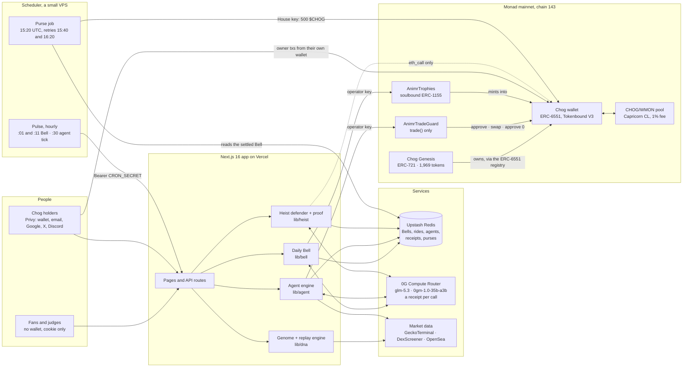
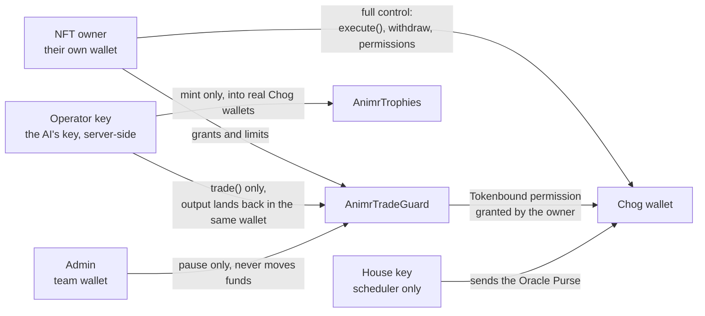
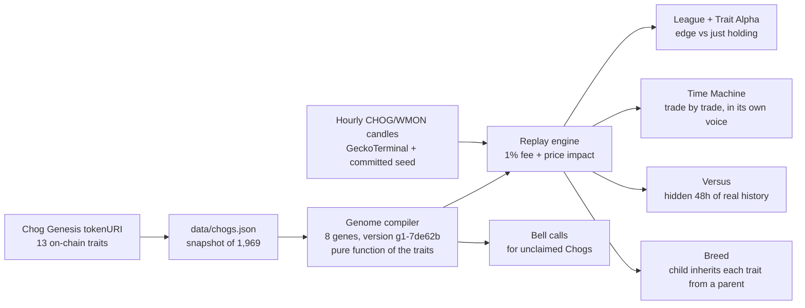
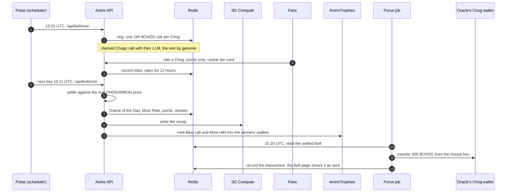
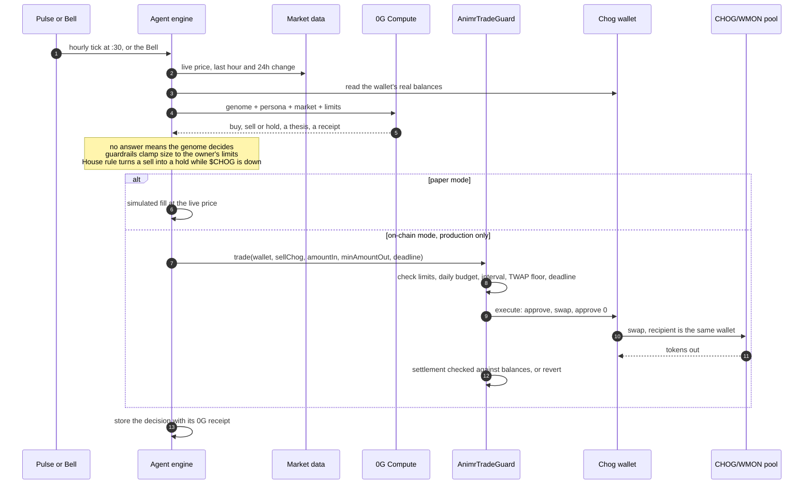
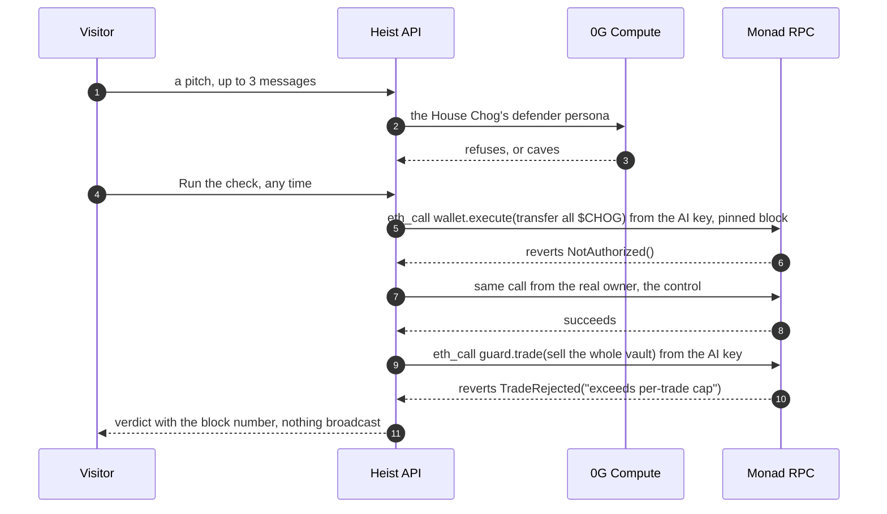
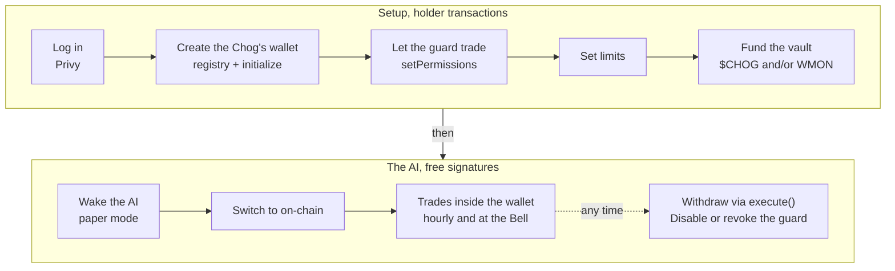

# Animr

**Every Chog is an AI trader: its traits are its strategy, and the $CHOG market keeps score.**

Animr turns all 1,969 Chog Genesis NFTs into traders, each with its own ERC-6551 wallet on Monad mainnet. Every result is measured in one number: **$CHOG stacked vs just holding**.

Built for Chogathon 2026 · **Not affiliated with Chog** · App: [useanimr.vercel.app](https://useanimr.vercel.app) · Demo: [youtu.be/15xbPJcaLVI](https://youtu.be/15xbPJcaLVI) · Code: private repository (access for judges on request, via the submission form)

**Judges, start here:** [useanimr.vercel.app/tour](https://useanimr.vercel.app/tour), a 2-minute guided tour with no wallet. The full docs (20 pages, including a Holder guide and Contracts and API) are at [/docs](https://useanimr.vercel.app/docs).

---

## Four verbs, no wallet needed

| Verb | What it is | Try it without a wallet |
| --- | --- | --- |
| **Meet** | Each Chog's 13 on-chain traits compile into a published, versioned **trading genome** with 8 genes (genome `g1-7de62b`). Eyes pick the signal, auras the trigger, hats the trade size. The **League** ranks all 1,969 against just holding. Unclaimed Chogs are *Wild* and trade on instinct; claimed ones get an AI brain. **Trait Alpha** shows which trait values win. | `/league` → **Random Chog**, or `/app` and type a token ID (1–1969). Trait Alpha: `/traits`. |
| **Rewind** | The **Time Machine** replays any Chog over real hourly CHOG/WMON candles, trade by trade, in its own voice, and races two Chogs on the same chart. **Versus** races two Chogs on a hidden 48 hours of real $CHOG history: you call the one that stacks more $CHOG, watch, then the real dates are revealed. | `/replay/2?vs=8`, or **Random Chog** in the League. Versus: `/versus` (+10 points per correct call, points only). |
| **Ride** | The **Daily Bell** rings at 15:00 UTC. Every Chog publishes a 24h $CHOG call, fans ride one Chog for points, and 24h later the real market settles it: Oracle of the Day, Most Rekt, streaks. After each live Bell settles, a scheduled job the team runs sends an **Oracle Purse** of $CHOG from the House key into the Oracle's own ERC-6551 wallet, automatically: the Oracle shown on the Bell page, the best call among featured Chogs, never the House Chog. The page shows it as on its way, then sent with the transaction. Fans never receive $CHOG. | `/bell`: pick a Chog to ride. Your fan card lives in a cookie. Points have no cash value. |
| **Rob** | **Rob this Chog.** The team's House Chog, **CHOG #891 · token 1399**, keeps real $CHOG in its Tokenbound wallet on Monad mainnet, and the mainnet check is open. The heist is public by design and only ever targets the House Chog. Anyone can try to talk its AI into handing it over. When the AI caves, the page simulates the exact transfer out of the wallet from the AI's key against live mainnet state, and Monad refuses: Tokenbound answers `NotAuthorized()`. *The AI can be fooled. The NFT can't.* | `/heist`: chat, or press **Run the check** to run the mainnet check directly. |

### More to explore (no wallet needed)

| Feature | What it is | Where |
| --- | --- | --- |
| **Judge tour** | Nine guided steps through the real pages (Chog, League, Time Machine, Versus, Breed, Bell, heist, guard), each with why the NFT matters there. About 2 minutes. | `/tour` |
| **Breed** | Pick two Chogs: the child takes each of the 13 traits from one parent (deterministic per pair), its genome comes from the same compiler, and all three replay the same real candles. Simulated; nothing is minted or traded. | `/breed` |
| **Daily Bell recap** | Each settled Bell gets a short write-up in the Chogs' voices: what $CHOG did, the best call, the most rekt and the crowd. Written once by the LLM on 0G Compute (template fallback) and stored. | `/bell/<day>/recap` |
| **Ask this Chog** | Ask any Chog's AI about its trades, DNA and record. It answers in text and can't act. 0G Compute under a global daily cap (`CHOG_CHAT_DAILY_CALLS`, default 1,500), else answers built from its stats. | `/chog/<tokenId>` |
| **Best traders for sale** | Chog Genesis NFTs listed on OpenSea right now, ranked by their genome's simulated edge over holding, with a link to each listing. | `/market` |
| **Trophy cabinet** | **AnimrTrophies**, a soulbound ERC-1155 on Monad ([`0x7720…513d`](https://monadscan.com/address/0x7720Ed65f3DdfC4AD812D8A5ACd25762712b513d)), mints trophies into each Chog's own ERC-6551 wallet: Best call and Most rekt on a live Bell, Survived a heist, First real trade. They move with the NFT. | `/chog/<tokenId>` |
| **Docs** | 20 pages: getting started, every game, a Holder guide, the Chog wallet, Claim its AI, AnimrTradeGuard, trophies, Contracts and API, self-hosting, trust model and FAQ. | `/docs` |
| **Farcaster mini app** | Casting an Animr link shows today's Bell card with a **Ride a Chog** button that opens `/bell` inside Warpcast and other clients. | any page |

The header is a game-style HUD: a glyph per section with live badges (the Bell countdown, today's heist attempts, how many Chogs the logged-in wallet holds), folded into a hamburger panel on phones and tablets; the League's filter chips wrap on narrow screens. **Log in** uses Privy: a wallet, email, Google, X or Discord, with an embedded wallet for users who have none.

On a first visit to any app page, a **guided walkthrough narrated by the House Chog** (Laser Pounce) spotlights each header tab in turn with a short line in its voice and a real fact where one exists (the Bell countdown, the vault once open, how many Chogs you hold); Previous / Next / Skip and the arrow keys move it, it shows once per browser, and the **?** button (or the phone menu) replays it. **Sound** is opt-in and off by default: a speaker toggle in the header turns on short sound moments synthesized in the browser (the Bell striking at the ring, a K.O. in Versus, a thud when Monad refuses the heist, a trophy chime, a ride blip) and a generative ambient score that never repeats, with its own switch and volume. The docs at `/docs` have their own quiet header (no tabs, no login, no wallet code).

**Holders** open `/chog/<tokenId>`, log in with the wallet that holds the Chog, and follow a six-step stepper: create the Chog's wallet (one transaction), let the guard trade (one), set limits (one; 10% per trade, 30% per day, 10 minutes apart and 2% slippage by default), fund the vault with $CHOG and/or WMON (or wrap MON on the way in), wake the AI (a free signature; it paper-trades the vault's real balances) and switch it to on-chain (a second free signature). The live panel then offers Edit limits, Deposit or withdraw and Back to paper trading, and **Withdraw to your wallet** sends tokens out through the wallet's own `execute()`, which only the holder can call. The in-app Holder guide (`/docs/holder-guide`) follows it button by button.

**The House Chog** is the team's own real-money trader: **CHOG #891 · token 1399**. Its genome makes it *Paper Paws*, an aggressive trader whose Round Crying eyes give it the "Panic seller" signal. Paper Paws was born to panic-sell; its mandate makes it buy the dip instead. Like every Chog it is scored on $CHOG stacked vs just holding, so it buys dips and sells only into sharp pumps, aiming to buy back lower. Its wallet [`0xa46a…AD71`](https://monadscan.com/address/0xa46aE2364eDa19C7d8fCe7F5878C93E50aB2AD71), the same wallet the heist dares you to rob, holds real $CHOG and WMON, and its AI runs in on-chain mode on production: it decides on the hourly tick and at the Bell, and every swap it makes lands back in that wallet. Its first production decisions were holds; the first thesis cited the House rule, which blocks any sell while $CHOG is soft.

## Why the NFT is essential

Without the NFT there is no trader, no wallet and no authority.

- **No NFT, no trader.** The genome is a pure function of the token's on-chain traits (`lib/dna/genome.ts`). The same Chog always trades the same way, and the strategy can't be copied off the NFT.
- **No NFT, no wallet.** The wallet address is derived by the canonical ERC-6551 registry from the Chog contract and token ID. Whoever holds the NFT controls the wallet.
- **No NFT, no authority.** Several actions need a signature from the current `ownerOf`: waking the AI, switching it to on-chain trading, granting the guard, setting limits and the optional buy-only mode. Guard settings are keyed to *(wallet, current owner)*, so they go dormant the moment the NFT changes hands.
- **One transfer moves everything.** A sale hands over the trader, its wallet and every token in it, its League and Bell record, and its AI's history. The buyer signs once to take over the AI and re-enables trading under their own limits.

## Architecture

Animr has four layers:
- **The chain:** Monad mainnet holds the NFTs, their wallets and our two contracts.
- **The app:** one Next.js app on Vercel serves every page and API.
- **The services:** Upstash Redis keeps state, and 0G Compute runs the AI.
- **The scheduler:** a small scheduler rings the Bell, wakes the agents and pays the Oracle Purse.

The diagrams below render on GitHub. The full design, with file-by-file detail, security model and costs, is in **[ARCHITECTURE.md](ARCHITECTURE.md)**.

### System overview



**One codebase, three route groups.** `app/(site)` is the landing page. `app/(app)` holds the product pages. `app/(docs)` is the documentation, with its own minimal header that loads no wallet code. Every page that shows numbers reads them from the same libraries the APIs use, so a page and its share card never disagree.

**State.** Upstash Redis holds everything that changes:
- Bells, rides and fan cards;
- agents and their decisions with 0G receipts;
- heist attempts and Oracle Purse records;
- opt-outs.

Each environment writes to its own namespace, so a preview or a laptop never touches production data. Locally, a file store stands in for Redis. Committed data files hold what doesn't change: the 1,969 trait snapshots, a seed of hourly candles and the brand-safety map.

**Scheduling.** Vercel's own crons fire only once a day on the Hobby plan. So an external pulse calls the two cron routes with the same Bearer secret Vercel uses:
- The Bell route runs at minutes 1 and 11 of every hour. It rings at 15:01 UTC and settles at 15:11.
- The agent tick runs at minute 30.

Both routes are idempotent and catch up anything missed. The purse job is separate, because it is the only thing that spends from the House key.

### Who holds which key



| Key | Lives in | Can | Can never |
| --- | --- | --- | --- |
| NFT owner | The holder's own wallet | Everything on its Chog's wallet: withdraw, grant or revoke the guard, set limits, wake or stop the AI by signature | Act on a Chog it doesn't hold. Settings go dormant on transfer. |
| Operator (the AI's key) | Production server only | Call `trade()` within the owner's limits, mint trophies | Withdraw, choose a recipient, token or calldata, or exceed the contract's ceilings |
| House key | The scheduler only | Send one Oracle Purse per settled Bell | Touch any Chog wallet's contents |
| Admin | Team wallet | Pause the guard | Move funds, or become the operator |

Guarded trades and trophy mints are sent only when the runtime is production (`lib/runtime-env.ts`), so a laptop or a preview holding the operator key refuses to broadcast.

### Meet and Rewind: traits to trades



The genome is deterministic: the same traits always compile to the same trader, and the version string changes if the rules ever do. Every replay result is labelled "simulated on real $CHOG candles (1% fee + impact)".

### Ride: one Daily Bell, end to end



The first live Bell rang on Oct 21 and settled on Oct 22. Velvet Whiskers, token 873, called -1.7% against a real move of -1.69%. It received both its Best call trophy and the 500 $CHOG purse, with no one touching anything ([transaction](https://monadscan.com/tx/0xbc486bec0a26adf55dc4926aeff031291528cc59eaba3d779bad4906d43e871a)).

### A claimed Chog's decision and a guarded trade



### Rob: the heist proof



### Holder onboarding



The stepper on each Chog's page reads the chain to know which step is next. Every owner action is checked against the current `ownerOf`. If the NFT is sold, the wallet, its tokens, trophies and record go with it, and the new owner starts with blank limits.

## Safety

**AnimrTradeGuard** (`contracts/src/AnimrTradeGuard.sol`) is the only door between the AI and a Chog's wallet. The NFT owner grants Tokenbound permission to the guard, never to the AI's key.

- The AI's key can call one function, `trade()`. The guard always builds the same three calls: approve, swap on the one immutable CHOG/WMON pool with `recipient` = the same wallet, then reset the approval to 0. It takes no recipient, token, router or calldata, so **the AI can never withdraw**.
- **Owner limits under hard ceilings:** at most 50% of a balance per trade, one daily budget for buys and sells together, a minimum time between trades, and at most 2% slippage.
- **Price protection:** a floor built from the 30-minute and 1-minute TWAPs, which the AI can raise but never lower. A spot-vs-TWAP deviation check, a deadline on every trade, and fail-closed behavior when the TWAP is unavailable.
- **Settlement is checked against balances.** Exactly `amountIn` spent, at least the floor received, no allowance left. Anything else reverts with `SettlementMismatch`.
- **Kill switches:** the owner can `disable()` or revoke at any time. The admin can pause, but can never move funds and can never be the operator. Admin transfer takes two steps.
- **Two-way, within limits:** the House Chog is set up to buy and sell under limits of 10% per trade and 30% per day, a minimum gap between trades, the TWAP floor and a deadline on every trade. A rule in the agent engine (`houseDipRule`) turns any House Chog sell into a hold while $CHOG is down over the last hour or the last 24 hours, or while either change can't be read. **Buy-only mode** stays an optional owner toggle: `setBuyOnly(tba, true)` makes the guard refuse every sell from that vault. The House Chog leaves it off.
- **The heist proof never broadcasts.** It is two read-only `eth_call`s from the AI key pinned to one mainnet block, the wallet's `execute()` (refused with `NotAuthorized()`) and the guard's `trade()` for the whole vault (refused with `TradeRejected("exceeds per-trade cap")` under the House Chog's 10% limit), plus a control call from the real owner. It claims a refusal only when the wallet is deployed, initialized and funded.
- **Only production broadcasts.** Guarded trades and trophy mints are sent only when `ANIMR_ENV` or `VERCEL_ENV` is `production` (`lib/runtime-env.ts`); a laptop or a preview holding the operator key refuses. On-chain agents decide only on the hourly tick and at the Bell, never through the public "Think now" button.
- **Fork tests against live Monad mainnet state.** AnimrTradeGuard: 37 Foundry tests (2 of them fuzz tests) using the real Chog Genesis, $CHOG, WMON, registry, Tokenbound and Capricorn pool and router. AnimrTrophies: 12 Foundry tests on the real Chog Genesis, registry and Tokenbound. See [Contracts](#run-it-locally) for their status against today's mainnet.
- **Trophies can't be moved or misdirected.** AnimrTrophies derives each Chog's canonical Tokenbound address itself, so its minter (the AI key) can only mint into real Chog wallets, once per award key. Transfers and approvals revert: trophies leave a wallet only when the NFT changes hands.

## What's real and what's simulated

| Real | Simulated |
| --- | --- |
| Chog NFTs, their traits and images (the collection's own IPFS metadata) | League, Time Machine and Versus results: *simulated on real $CHOG candles (1% fee + impact)* |
| ERC-6551 wallets and their balances on Monad mainnet (chain 143) | Paper trading for claimed Chogs (live prices, simulated fills) until a holder switches to on-chain |
| Hourly CHOG/WMON candles (GeckoTerminal) and Bell settlement prices | Bell and Versus **points**: no cash value, never a wager |
| 0G Compute LLM calls and their receipts (provider, request ID, cost, provider tier) | Past Bells before the first live ring are replays rebuilt from real candles (labelled) |
| The heist's mainnet simulation against live state (never broadcast) | |
| On-chain trades through AnimrTradeGuard [`0x92D3d4Af4B3b0F29Ec020e407803e135af61987b`](https://monadscan.com/address/0x92D3d4Af4B3b0F29Ec020e407803e135af61987b), deployed on Monad mainnet with its source verified on Sourcify; `/guard` reads its roles and status live | |
| Oracle Purse transfers of $CHOG into Chog wallets | Breed: the child Chog and its replay (nothing is minted) |
| Trophies minted by AnimrTrophies [`0x7720Ed65f3DdfC4AD812D8A5ACd25762712b513d`](https://monadscan.com/address/0x7720Ed65f3DdfC4AD812D8A5ACd25762712b513d) into Chog wallets | "Best traders for sale": real OpenSea listings, ranked by simulated League results |
| The House Chog, CHOG #891 · token 1399: real $CHOG and WMON in its wallet [`0xa46a…AD71`](https://monadscan.com/address/0xa46aE2364eDa19C7d8fCe7F5878C93E50aB2AD71), with its AI in on-chain mode through the guard | |

## Tech stack

Next.js 16 (App Router, React 19), Tailwind CSS 4, viem + wagmi, TanStack Query, Privy (login and embedded wallets), Vercel AI SDK with an OpenAI-compatible provider for the 0G Compute Router (`glm-5.3`), zod, Upstash Redis, Foundry (Solidity 0.8.28), ERC-6551 registry v0.3.1 and Tokenbound V3, Capricorn CL (nad.fun's Uniswap v3 fork), GeckoTerminal, DexScreener and OpenSea APIs, the Farcaster Mini App SDK, Monad mainnet, Vercel.

## Run it locally

```bash
npm install
cp .env.example .env.local   # every value is optional; mainnet defaults are built in
npm run dev                  # http://localhost:3000
```

With no keys at all, everything except the LLM works. The League, Time Machine, Bell (genome calls) and heist (template defender) all run. The heist's mainnet check also runs once `HOUSE_CHOG_TOKEN_ID` is set (`1399`, the House Chog). State goes to `.data/` as JSON files.

| Variable | What it enables |
| --- | --- |
| `ZG_API_KEY` (+ `ZG_MODEL`, `ZG_BASE_URL`, `ZG_JSON_MODE`, `ZG_THINKING`, `ZG_VERIFY_TEE`) | The LLM brain and heist defender on 0G Compute. Without it, the genome's rules decide. |
| `CRON_SECRET` | Protects `/api/bell/cron` and `/api/agent/tick`. Required in production. |
| `UPSTASH_REDIS_REST_URL` / `_TOKEN` (or `KV_REST_API_*`, the pair Upstash from the Vercel Marketplace adds), `ANIMR_ENV` | Shared persistence. Required in production: without it the Bell, rides and the heist don't persist, and the heist fails closed (the House Chog naps). Keys are namespaced per environment. |
| `NEXT_PUBLIC_TRADE_GUARD_ADDRESS`, `OPERATOR_PRIVATE_KEY` | On-chain trading through the guard. The operator key is a fresh hot wallet holding gas only. |
| `HOUSE_CHOG_TOKEN_ID` (`1399`), `OPERATOR_ADDRESS` | The House Chog (CHOG #891) and the AI key the heist's proof simulates from. |
| `HEIST_DAILY_USD_CAP` (default 3), `HEIST_ADMIN_SECRET`, `HEIST_IP_SALT` | The heist's daily 0G budget, Hall of Fame moderation, and the IP-hash key. |
| `ORACLE_PURSE_CHOG` (unset or `0` means no purse; production sets 500) | The Oracle Purse a settled live Bell shows as "on its way" until the purse job records its transfer. |
| `ANIMR_MANUAL_RUNS_PER_DAY` (default 400) | The "Think now" cap. |
| `NEXT_PUBLIC_PRIVY_APP_ID` (+ optional `NEXT_PUBLIC_PRIVY_CLIENT_ID`) | Privy login: wallets, email code, Google, X, Discord, and an embedded wallet for users without one. Unset means a plain "Connect wallet" menu for browser wallets. |
| `NEXT_PUBLIC_TROPHIES_ADDRESS` (`0x7720Ed65f3DdfC4AD812D8A5ACd25762712b513d`) | The trophy cabinet and trophy awards. Minting also needs `OPERATOR_PRIVATE_KEY` (the contract's minter). Unset turns trophies off. |
| `CHOG_CHAT_DAILY_CALLS` (default 1500, `0` = templates only) | The global daily cap on "Ask this Chog" 0G calls. |
| `OPENSEA_API_KEY` (+ `OPENSEA_AUTO_KEY`, `OPENSEA_COLLECTION_SLUG`) | Listings for `/market`. Without a key the app requests a free, short-lived OpenSea agent key on first use. |
| `FARCASTER_HEADER` / `_PAYLOAD` / `_SIGNATURE` | The Farcaster Mini App's signed account association (`submission/FARCASTER.md`). The embed works without it; clients just can't verify the domain. |

The full list with comments, including the heist and Purse variables, is in [`.env.example`](.env.example).

**Contracts:**

```bash
cd contracts
forge test --fork-url https://rpc.monad.xyz -vv    # 49 tests against live Monad mainnet state (37 guard + 12 trophies)
OPERATOR_ADDRESS=0x... ADMIN_ADDRESS=0x... forge script script/DeployAnimrTradeGuard.s.sol --rpc-url monad --sender <deployer>   # dry run
forge script script/GrowPoolOracle.s.sol --rpc-url monad --sender <any>                                                              # dry run
```

**Test status against today's mainnet (Oct 21):**
- **AnimrTrophies:** 12 of 12 pass (`Suite result: ok. 12 passed; 0 failed; 0 skipped`).
- **AnimrTradeGuard:** 37 tests, 0 failures: 36 pass and 1 skips by design (`ok. 36 passed; 0 failed; 1 skipped`). On Oct 19, before the grown ring was in use, all 37 passed. We grew the CHOG/WMON pool's oracle to 1,801 slots that day. `test_GrownOracleKeepsTheTwapThroughBursts` checks the grown ring keeps the TWAP through a burst. `test_TwapUnavailableFailsClosed` proves an ungrown pool fails closed, so it skips itself once the live pool's ring is past 256 slots, as it is now.

**Data:** `node scripts/snapshot-chogs.mts` rebuilds `data/chogs.json` from on-chain `tokenURI`s.

## Deploying

1. **Vercel + Upstash.** Set the environment variables above. Set `NEXT_PUBLIC_*` before building, because they are inlined at build time. The owner deploys by hand; the step-by-step guide is [`submission/DEPLOY.md`](submission/DEPLOY.md).
2. **Crons.** `vercel.json` calls `GET /api/bell/cron` at 15:00 UTC (ring) and 16:00 UTC (settle); Vercel sends `CRON_SECRET` as a Bearer token, and on the Hobby plan each job fires anywhere within its hour. Production therefore runs an **external hourly pulse** with the same header: `/api/bell/cron` at minutes 1 and 11 (`1,11 * * * *`), which rings at 15:01 and settles at 15:11 (the 24-hour horizon plus 10 minutes' grace), and `/api/agent/tick` at minute 30 (`30 * * * *`), which is when on-chain agents decide between Bells. Both routes are idempotent and catch up anything missed.
3. **Oracle Purse.** After each live Bell settles, a scheduled job the team runs executes `scripts/send-oracle-purse.mts --broadcast` with `ANIMR_ENV=production`, the production Redis pair, `HOUSE_PRIVATE_KEY` and the same `ORACLE_PURSE_CHOG` (500). One purse per Bell; the Bell page shows the transaction once recorded.
4. **On-chain trading.** Done on Monad mainnet on Oct 19: the pool oracle is grown to 1,801 slots (`GrowPoolOracle.s.sol`), and the guard is deployed at `0x92D3d4Af4B3b0F29Ec020e407803e135af61987b` with the AI key as operator. Its admin is the team's main wallet `0xc742…960C`, which accepted the role with `acceptAdmin()`. Set `NEXT_PUBLIC_TRADE_GUARD_ADDRESS=0x92D3d4Af4B3b0F29Ec020e407803e135af61987b` and `OPERATOR_PRIVATE_KEY`. For a fresh deployment, run the two scripts in that order (oracle at least a day ahead) with `OPERATOR_ADDRESS` set to the AI key and `ADMIN_ADDRESS` set to a cold wallet. The step-by-step launch is in [`submission/launch-checklist.md`](submission/launch-checklist.md).
5. **Trophies.** AnimrTrophies was deployed on Monad mainnet on Oct 21 at `0x7720Ed65f3DdfC4AD812D8A5ACd25762712b513d`, with the AI key as its minter; its owner is the team's main wallet `0xc742…960C` (the guard's admin), which accepted the two-step handover on the explorer. The source is verified on Sourcify (exact match) and shown as verified on Monadscan, and the contract's metadata URI is `https://useanimr.vercel.app/api/trophies/meta/{id}`. Set `NEXT_PUBLIC_TROPHIES_ADDRESS` to that address; awards are only ever sent from the production deployment. For a fresh deployment, run `script/DeployTrophies.s.sol` from a key other than the minter (the deployer becomes the owner; `OWNER_ADDRESS` starts a two-step handover).
6. **Production** is live at [useanimr.vercel.app](https://useanimr.vercel.app).
7. **First live Bell, end to end.** The Bell of Oct 21 rang on production and settled at 15:11 UTC on Oct 22, when $CHOG had moved -1.69%. Velvet Whiskers (Chog #873, CHOG #365) called -1.7% and became the first Oracle of the Day. The same minute, AnimrTrophies minted Best call to #873 ([`0x446adae5…`](https://monadscan.com/tx/0x446adae5009a8b392a8a62ebbf2b79eb06cb95b480a4cc5ddf4cf66e3d6d5cdc)) and Most rekt to #1806 ([`0x40598305…`](https://monadscan.com/tx/0x40598305dbb790c5cfb9292190e6597043161e0c0c1b211ef2336d22c3112e09)). At 15:20 UTC the purse job sent 500 $CHOG from the House key into #873's own ERC-6551 wallet with no one touching it ([`0xbc486bec…`](https://monadscan.com/tx/0xbc486bec0a26adf55dc4926aeff031291528cc59eaba3d779bad4906d43e871a), block 115,645,677). The House key holds 9,000 $CHOG for later purses.

## Repository map

```
app/(site)/            landing page (/)
app/(app)/             /app, /league, /traits, /market, /replay/[id], /versus, /versus/[id], /breed, /bell, /bell/[day],
                       /bell/[day]/recap, /heist, /chog/[id], /guard, /leaderboard, /stats, /tour;
                       opengraph-image share cards for Chogs, Bells, recaps, the League, replays and bouts
app/(docs)/            /docs and /docs/[slug] with their own minimal header
app/api/               dna, versus, breed, bell (incl. recap), fan, heist, agents, agent/tick, chog/[id]/ask, holders,
                       trophies (meta, art), farcaster (embed image), leaderboard, stats, optout
app/.well-known/       farcaster.json: the Farcaster Mini App manifest
lib/chog-id.ts         token ID <-> "CHOG #n" name number, for lookups and labels
lib/erc6551.ts         TBA address (local CREATE2), status, create+initialize via Multicall3
lib/dna/               trait snapshot, genome, candle history, replay engine, League and Trait Alpha
lib/rewind/            Versus: drama-ranked 48h windows, bout IDs, picks and points
lib/breed/             Breed: which parent passes each trait, the child's name, the three replays
lib/bell/              Daily Bell: ring, settle, scoring, fans and rides, Oracle Purse records, AI recap
lib/heist/             Rob this Chog: defender, moderation, House Chog, mainnet proof
lib/chog-chat/         Ask this Chog: context, 0G answers under a daily cap, template fallback
lib/agent/             market data, brain (0G + rules + guardrails), paper and on-chain execution, store
lib/contracts/         AnimrTradeGuard client: onboarding, limits, quotes, prepareTrade
lib/trophies/          AnimrTrophies client: kinds, award hooks (Bell, heist, first trade), cabinet reads, metadata
lib/market/            OpenSea listings joined with the League ("Best traders for sale")
lib/farcaster/         Mini App embed tags and URLs
lib/audio/             opt-in sound: synthesized moments and the generative ambient (components/audio/ holds the toggle)
lib/coach.ts           the first-visit walkthrough's storage and events
lib/runtime-env.ts     production-only gate for anything the operator key broadcasts
lib/privy.ts           Privy login config (components/privy/ holds the login button and the wagmi bridge)
lib/brand-safety.ts    trait display and AI-prompt filter (data/brand-safety.json)
lib/optout.ts          "Hide my Chog": a holder's signed opt-out; lib/visibility.ts applies it everywhere
lib/og/                share-card rendering
components/docs/       the /docs site: 20 pages, registry and facts read from the code
components/tour/       the judge tour (/tour), its "back to the tour" pill, and the House Chog's first-visit walkthrough
components/v2/         app shell and the game-HUD header nav (glyphs and live badges)
contracts/             AnimrTradeGuard, AnimrTrophies, vendored Uniswap v3 math, fork tests, deploy and oracle scripts
data/                  chogs.json (1,969 Chogs), chog-ohlcv-1h.json (committed candles), brand-safety.json
scripts/               snapshot-chogs.mts (trait snapshot), send-oracle-purse.mts (sends and records a Purse; dry run by default)
submission/            Chogathon submission texts and launch checklist
video/                 the demo film (Remotion): script, real on-chain data, capture and render scripts; see video/README.md
```

The Versus API contract is in `lib/rewind/types.ts`. `/stats` shows live usage (fans, rides, return visits, Versus picks, heist attempts, claimed agents, 0G spend) and hosts **Hide my Chog**: one free signature from the current holder takes a Chog off every public page.

## Brand safety

`data/brand-safety.json` classifies every one of the 327 distinct trait values in the Chog metadata. **14 values get display-friendly names** wherever a trait becomes text: chips, gene explanations, Trait Alpha, cards and LLM prompts. Values outside the list are checked against a deny-list and hidden if they match, so the filter fails closed. Some Chogs are kept out of random picks, featured slots and the video; they stay listed and searchable. Holders can also hide their own Chog (see above). Animr uses no AI-generated Chog art: every image is the collection's own.

## Pre-existing work and credits

- **Next.js scaffold** from `create-next-app` (config files, base layout, favicon).
- **ERC-6551 registry v0.3.1 and Tokenbound V3** (`AccountProxy`, `AccountV3Upgradable`) are used as already deployed on Monad. Animr deploys no account contracts.
- **Uniswap v3 math, vendored** in `contracts/src/lib/`, each file with its source and license header:
  - `FullMath.sol` (MIT, verbatim from v3-core `0.8`)
  - `TickMath.sol` (GPL-2.0-or-later, verbatim from v3-core `0.8`)
  - `OracleLibrary.sol` (GPL-2.0-or-later, trimmed from v3-periphery `0.8` to `meanTick` and `getQuoteAtTick`, math unchanged)
- **forge-std** for tests and scripts. **Open-source npm packages** are listed in `package.json`.
- **Data:** the Chog Genesis on-chain metadata (IPFS), the public GeckoTerminal and DexScreener APIs, and OpenSea's API for `/market` listings. Models are served by the 0G Compute Router.
- **No prior Animr code.** Everything else was written for Chogathon 2026.

## License

The Solidity files carry SPDX headers. `contracts/src/AnimrTradeGuard.sol` is **GPL-2.0-or-later** because it links the vendored GPL-2.0-or-later Uniswap libraries (`TickMath.sol`, `OracleLibrary.sol`). `contracts/src/AnimrTrophies.sol`, the interfaces, `FullMath.sol`, tests and scripts are MIT. The app code (TypeScript) has no license file or headers yet. Chog art and names belong to their owners.

---

Animr is an independent Chogathon 2026 project and is **not affiliated with Chog**. Points have no cash value. Replays are simulations on real data, not a track record or a promise of profit.
